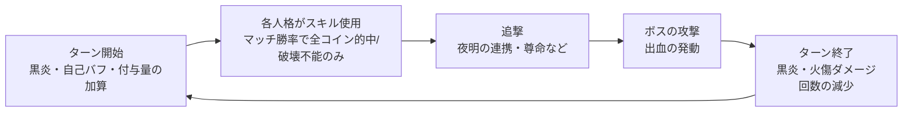

# analysis/ — 内部評価用データ

人格・編成を評価するための内部データと計算。**サイトの画面には出さない**(src/ から import しない)。
ここの結果は、ガイドや teams.json を書くときの判断材料として使う。

評価方針は次のとおり。

- ボス戦(集中戦闘)を重視し、鏡ダンジョンは参考程度にとどめる。
- 根拠は「wiki の評価ページ」「ユーザーの判断」「このデータから計算で得られる知見」の3つ。
- 計算式は docs/battle-formulas.md に従う。

## 構成

```
analysis/
  sim/
    types.ts          人格プロファイルの型(付与・回数・振動爆発・発動・自己バフ)
    simulate.ts       ボス1体相手の状態異常シミュレーター(モンテカルロ)
    simulate.test.ts  処理のテスト、プロファイルと人格データの照合
    report.ts         teams.json の状態異常編成をすべて回して reports/ に書き出す
    profiles/
      index.ts        全プロファイルの集約。スキルの素の威力を人格データから埋める
      helpers.ts      プロファイルを書くための短縮関数
      mods.ts         スキルの威力・ダメージ量の補正(「対象の火傷6につきコイン威力+1」など)
      burn.ts など    編成ごとの人格プロファイル(効果文を人手で分解したもの)
  reports/
    status-teams.md   実行結果(npm run analyze で再生成)
```

同じ人格は1つのファイルにだけ書く。複数の編成に出る人格は、最初に出る編成のファイルに置く。

## 使い方

| 目的 | コマンド | 結果 |
|---|---|---|
| 結果を再生成する | `npm run analyze` | analysis/reports/status-teams.md を上書きする(数分) |
| テストする | `npm test` | analysis/ のテストも含めて実行する |

## シミュレーターの前提



- **対象**: ボス1体・1部位とする。「敵2名へ」「ランダムな敵へ」も同じ対象に入るため、複数部位のボスより数値が高めに出る。
- **行動**: 各人格は毎ターン1回スキルを使う。順番は S1→S2→S3→S1→S1→S2 の繰り返しで、山札(S1×3・S2×2・S3×1)の近似。守備スキルは使わない。
- **マッチ**: スキルごとに設定した勝率でマッチに勝ち、全コインが的中する。負けたときは破壊不能コインだけが的中する。一方攻撃の追撃は必ず的中する。表の確率は70%。
- **スキルダメージ**: 威力 ×(1+クリティカル)×(1+ダメージ量)で計算する。
  - 威力は、基本威力・表のコイン威力に、効果文の条件付き補正(mods.ts)を加えたもの。
  - クリティカルは +20% に、クリティカルダメージ量の補正を足す。
  - 耐性・レベル差は全員同じ(等倍)として除外する。
  - 自分の資源(棺・教本・生体材料・充電威力など)に依存する補正は、溜まる時期と平均的な値で近似する。速度差の条件は6割で満たすとみる。
- **状態異常ダメージ**: 次の4種類を数える。
  - 火傷: ターン終了時・発動・黒炎
  - 出血: ボスが1ターンに投げるコイン6枚ごと
  - 破裂・沈潜: 被弾ごと
  - 特殊振動: 振動爆発の追加ダメージ
- **沈潜**: 精神力の無いボス(憂鬱ダメージになる)としてダメージに数える。精神力のあるボスでは精神力を削る効果になる。
- **数値の溜まり方**: 暁の火・炎蝶の棺・予知眼・弾丸・指令の加護などが溜まる時期は「何ターン目から」で近似している。各人格の notes を参照。
- **値の扱い**: 同期化Ⅳの値を使う。状態異常の上限は99。E.G.O・E.G.Oギフトは含めない。

## 読み方の注意

- 絶対値より、同じ前提での編成どうし・人格どうしの比較に使う。
- 「抜いたときに減るダメージ」は、他の味方を通じた貢献(追撃・付与量の加算・状態異常の土台づくり)も含む人格評価の指標。
- 格付けは、抜いたときに減るダメージを同じ編成の平均と比べたもの。
  - 強力: 1.3倍以上
  - おすすめ: 0.8〜1.3倍
  - 入れ替え候補: 0.4〜0.8倍
  - 非推奨: 0.4倍未満
- 入れ替え候補・非推奨の枠には、同じ囚人がいない全プロファイル人格を入れて試し、合計が増える上位を「入れ替え候補」として示す。
- 抜いたほうが合計が増える(負の値になる)人格は、破裂や沈潜の回数を消費する一方で、回数をあまり足さない。
- プロファイルは効果文の解釈を含む。新しい人格の追加や調整があったら、該当プロファイルを直してから再実行する。
